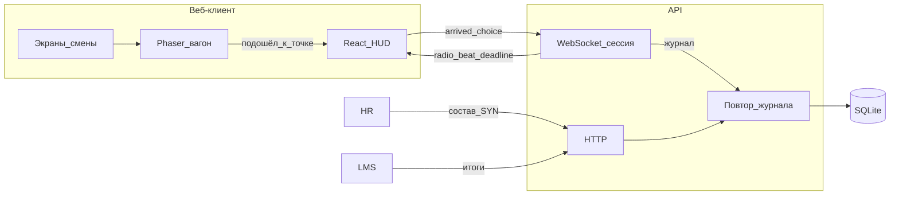
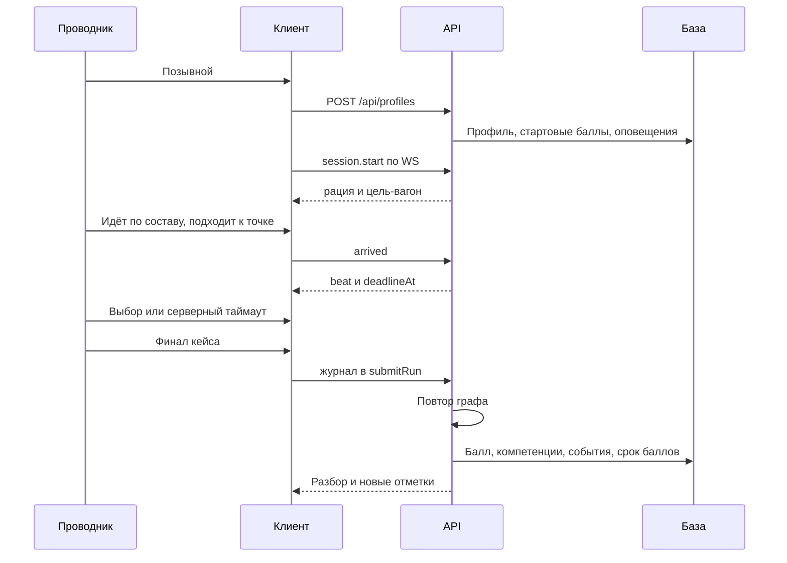

# Архитектура «Смена 400»

Тренажёр проводника ВСМ: нелинейные сценарии, таймер, две шкалы и очки компетенций. Демо не хранит персональные данные пассажиров и сотрудников — только синтетические позывные.

## Компоненты

Смена идёт в вагоне: Phaser рисует состав, React держит шкалы, рацию и выборы. Таймер стартует только после подхода к точке инцидента. Живой канал — `GET /api/ws` (upgrade). Сервер хранит текущую попытку в памяти и шлёт дедлайн; координаты спрайта по сокету не идут.

После финала тот же `submitRun` проигрывает журнал и пишет канонический балл. `POST /api/runs` с разбора дублирует запись и идемпотентен по `runId`. Если сокет не открылся, клиент ведёт ветку локально, как раньше.

Если API недоступен, профиль остаётся в `localStorage`. Это запасной контур локальной тренировки, не замена сервера.

## Последовательность смены

## Хранение

| Таблица | Зачем |
| --- | --- |
| `conductors` | Позывной, бригада, депо, опыт, компетенции, отметки |
| `point_lots` | Порции баллов и дата сгорания |
| `runs` | Итог попытки и журнал решений |
| `notifications` | Новые сценарии, челлендж, сгорающие и сгоревшие баллы |
| `events` | Шаги для аналитики |

Стартовые 40 баллов живут 3 дня, баллы за попытку — 30 дней. Просроченная порция списывается при следующем чтении профиля.

## Масштабирование

Живая смена держится в памяти процесса на время рации и дедлайна (`server/session.ts`). Балл по-прежнему считает повтор журнала, поэтому несколько реплик API можно ставить за балансировщик со sticky-сессией на `/api/ws`. Хранилище профилей — файл SQLite на томе `smena-data`. Граница хранения — `server/store.ts`: смена драйвера не трогает граф сценариев.

## Интеграции

- HR: `POST /api/integrations/hr/roster`, ключ `X-Integration-Key`, идентификаторы только `SYN-…`.
- LMS: `GET /api/integrations/lms/results?since=`.
- Контракт: `docs/openapi.yaml`, в рантайме `GET /api/openapi.yaml`.

Запросы с паспортом, СНИЛС, телефоном, почтой или адресом получают `422`.
