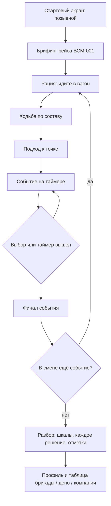

# Пользовательский сценарий

Проводник отрабатывает нештатную смену без живых пассажиров. Данные в демо синтетические: позывной вроде «К. Лебедев», бригада и депо, без документов и контактов.

## Поток

Отдельный вход «Разбор по кейсам» запускает один сценарий с чистыми шкалами. Это полигон, не рейс. Проводник всё равно выходит к составу у вагона 5 и идёт к точке кейса.

Во время подхода таймер не крутится. После взаимодействия на экране две шкалы: лояльность пассажира и рейтинг безопасности. Часть реплик ограничена таймером. Стрелки или A/D — идти, E или клик — подойти, клавиши 1–3 выбирают ответ.

После финала разбор показывает оценку события и строку на каждое решение: что сказано, как сдвинулись шкалы, какой узел открылся дальше.

## Рейс из трёх событий

1. **Вагон 4. Рука на груди.** Пассажиру плохо на скорости до 400 км/ч. Ранний вызов врача состава держит безопасность. Вода «на всякий случай» и молчание уводят в провал безопасности. Экстренная остановка — отдельный риск, не жест заботы.
2. **Вагон 2. Голос на весь премиум.** Конфликт взрослого и ребёнка в первом классе. Можно развести стороны, сразу звать охрану или встать на сторону VIP. Лояльность и безопасность здесь спорят.
3. **Вагон 7. Чёрная сумка у тамбура.** Бесхозный рюкзак. Протокол — не трогать и вызвать безопасность. Вскрытие сумки роняет рейтинг безопасности и закрывает отметку «Не вскрывать».

Полные графы лежат в `src/data/` и отдаются как `GET /api/scenarios/{id}`.

## Что остаётся у проводника

- Уровень и пять компетенций: коммуникация, протокол, холодная голова, эскалация, эмпатия.
- Отметки за протокол, скорость решения и целую смену без срыва таймера.
- Оповещения о новых кейсах, недельном челлендже и баллах, которые скоро сгорят.
- Рейтинг внутри бригады, депо и компании. В зачёт идёт лучший балл.
